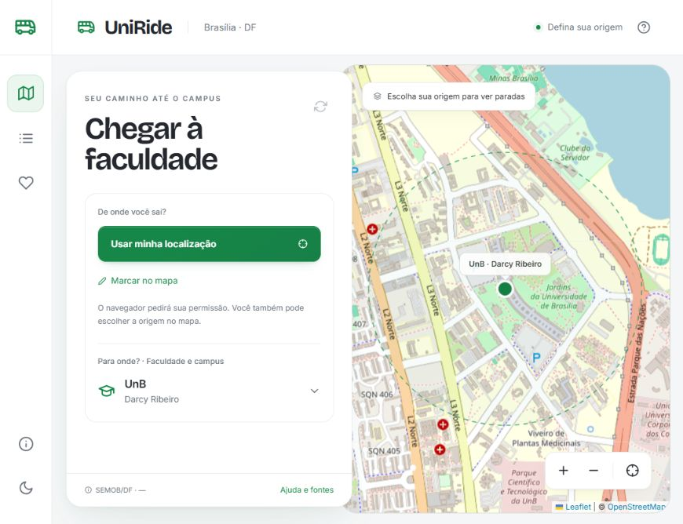

# UniRide · Brasília

Aplicação acadêmica de consulta de transporte público para chegar às faculdades do Distrito Federal. Escolha de onde você sai e o campus de destino para encontrar paradas próximas e linhas que passam perto dos dois pontos.

**[Abrir o UniRide — site público, sem login](https://uniride-campus-brasilia-lf.lipibcg.chatgpt.site/)**



## O que está disponível

- Origem pela localização do aparelho, com permissão, ou marcação manual no mapa.
- Paradas em até 800 metros da origem, ordenadas pela distância em linha reta.
- Linhas cujo mesmo traçado passa perto da origem e do campus escolhido.
- Traçados, horários de saída programados e posições recentes disponíveis na fonte pública da SEMOB/DF.
- 14 instituições e 29 campi: UnB, UniCEUB, UCB, UDF, IESB, UNIP, UNIPLAN, Projeção, Estácio, Anhanguera, IFB, UnDF/ESCS, Senac-DF e Unieuro.
- Favoritos por campus, busca, ajuda, temas claro/escuro e interface adaptada para computador e celular.

Não há reserva de lugares, informação de vagas ou lotação. O projeto é independente, sem vínculo oficial com a SEMOB ou as instituições de ensino.

## Rodar no computador

Requisito: **Node.js 20.10 ou superior** e npm. Não é necessário banco de dados, chave de API ou servidor Java para executar a versão publicada.

```sh
git clone https://github.com/felps310306/UniRIde.git
cd UniRIde/site
npm ci
npm start
```

Abra **http://127.0.0.1:4173**. `npm start` gera a aplicação e inicia o servidor local com o acesso à API.

Para apresentar usando apenas um arquivo, abra [APRESENTAR-UNIRIDE.html](APRESENTAR-UNIRIDE.html) no navegador após baixar o repositório. Essa versão é uma **amostra datada**, sem consulta à API e sem mapa-base. Para localização e dados atualizados, use o site hospedado ou o servidor local.

## Código e arquitetura

A pasta **`site/` contém o código completo da versão hospedada**: React, mapa Leaflet/OpenStreetMap, adaptador da SEMOB e servidor local. A publicação usa um Worker com a mesma API. A estrutura inicial do trabalho (React em `frontend/` e Spring Boot em `backend/`) foi removida do repositório e continua disponível no histórico de commits.

| Pasta ou arquivo | Conteúdo |
| --- | --- |
| `site/src/` | Telas, localização, mapa, campi, favoritos e estilos |
| `site/src/cco/` | Componentes adaptados do EscalaCCO, com procedência documentada |
| `site/src/design.css` | Tipografia e acabamento visual, preservando a paleta original |
| `site/server/` | Consulta pública SEMOB, filtros geográficos, cache e tratamento de falhas |
| `site/worker/` | Entrada da hospedagem |
| `site/scripts/` | Build, servidor local e geração da amostra |
| `site/tests/` | Testes de regras geográficas, calendário, localização e proxy |
| `site/docs/` | Decisões técnicas, cobertura, usabilidade e limites conhecidos |

As fontes Inter e Bricolage Grotesque estão incluídas no projeto, com suas licenças. O tema mantém o verde e as cores originais dos modos claro e escuro. Veja [dependências e atribuições](site/THIRD-PARTY-NOTICES.txt).

## Verificação e desenvolvimento

Execute dentro de `site/`:

```sh
npm test
npm run build
node scripts/validate-artifact.mjs
```

Edite `site/src/` e `site/server/`. O build gera `site/index.html`, `APRESENTAR-UNIRIDE.html` e o Worker em `site/dist/server/index.js`. A versão visual publicada em 06/11/2026 passou nos 17 testes e foi revisada em telas de computador e celular.

## Dados e limitações

A fonte pública da SEMOB foi acessada sem chave e sem cobrança nos testes. Sua disponibilidade, atualização e cobertura não são garantidas pelo UniRide. Horários são **saídas programadas no início da linha**, não previsões de chegada à sua parada.

A proximidade dos traçados **não comprova** a ligação entre uma parada e uma linha, a ordem do percurso ou o sentido correto de embarque. A aplicação ainda não calcula baldeações, caminho a pé ou itinerário porta a porta. Confirme os dados da viagem antes de embarcar.

A origem é usada na consulta e permanece apenas na memória da página; não é salva no histórico de URLs, nos favoritos ou no armazenamento do navegador. A consulta enviada ao servidor usa POST. Favoritos, tema e último campus ficam no navegador, sem conta nem sincronização entre aparelhos.

- [Documentação técnica e execução](site/README.md)
- [Diagnóstico do projeto e reaproveitamento do EscalaCCO](site/docs/DIAGNOSTICO.md)
- [Fonte SEMOB e contratos da API](site/docs/API-SEMOB.md)
- [Localização, paradas e limites de planejamento](site/docs/ORIGEM.md)
- [Aplicação das 10 heurísticas de Nielsen](site/docs/NIELSEN.md)
- [Instituições, campi e cobertura pendente](site/docs/COBERTURA.md)
- [Fontes de pesquisa dos campi](site/docs/CAMPI-PESQUISA.md)

## Hospedagem

O link é público e não depende de manter este computador ligado. Em consulta à [documentação oficial do Sites](https://learn.chatgpt.com/docs/sites) em 06/11/2026, a hospedagem está gratuita até **31/12/2026**. A partir de 01/01/2027, a política anunciada prevê medição de uso e cobrança de excedentes à franquia do plano. Isso não é garantia de disponibilidade contínua; o funcionamento também depende da fonte SEMOB.

Enviar código ao GitHub não publica automaticamente uma nova versão no Sites. O GitHub guarda o código; a hospedagem é atualizada pelo fluxo de build e publicação do Sites. A configuração de publicação está em `site/.openai/hosting.json`, sem credenciais.
